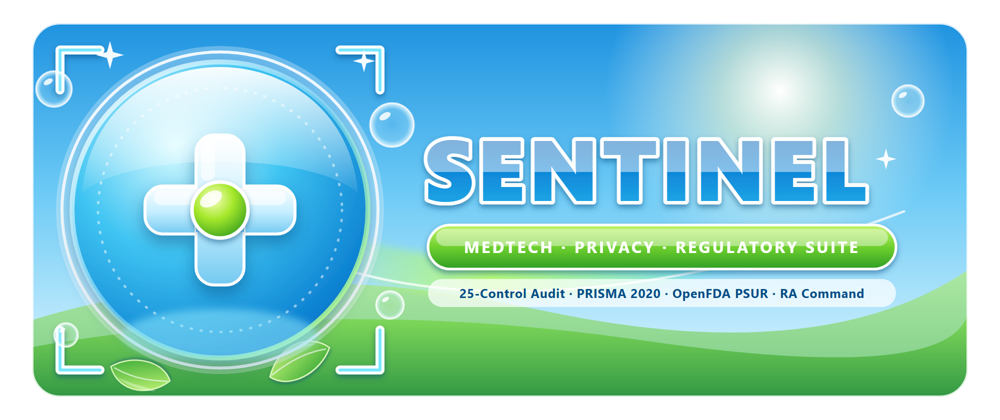

<div align="center">
  
</div>

# Sentinel — Passive Domain Hygiene CLI Utility

**Open-source Python CLI for inspecting public DNS (`DMARC`/`SPF`/`CAA`), TLS metadata, HTTP security headers, and basic HTML accessibility tags.**

[](https://www.python.org/)
[](https://opensource.org/licenses/MIT)
[](#architecture--25-control-matrix)

> **100% Free & Open-Source CLI Utility (MIT):** Built as a student systems-engineering exercise to consolidate public DNS-over-HTTPS, TLS, and HTTP header checks into local Word/Excel reports. *(See also the flagship research repo: [`computational-biology-portfolio`](https://github.com/kaledbouchagraoui7-bot/computational-biology-portfolio).)*

---

## Executive Overview

**Sentinel** performs a **100% passive, non-intrusive external compliance and security pre-check** on any public corporate domain — combining bilingual French/German/English privacy, email authentication, and accessibility checks into one **Technical Baseline Package** (`output/<domain>_audit/` and `<domain>_audit_package.zip`) for IT and DPO review (note: single technical checks can also be run manually via public tools like SSL Labs, MXToolbox, or Mozilla Observatory; Sentinel consolidates them into an editable Word/Excel pack prior to human verification):

1. **Executive Compliance & Risk Report (`.docx`)** — Landscape Word document with overall score, letter grade (`A+` to `F`), pillar breakdown, and priority remediation roadmap.
2. **Filterable Technical Findings Workbook (`.xlsx`)** — 4-sheet Excel workbook (`Findings_Matrix`, `Pillar_Summary`, `Remediation_Roadmap`, `README`) with frozen headers, AutoFilters, and conditional highlighting on failing controls.
3. **300-DPI Executive Scorecard (`.png` & `.pdf`)** — High-resolution visual diagnostic summary ready for IT & DPO reviews.
4. **Drop-In Remediation Configurations (`remediation_configs/`)** — Ready-to-review `_headers` (Cloudflare/Vercel/Netlify), `nginx_security_headers.conf` (Nginx/Apache), and `dns_remediation_records.txt` (DMARC, SPF, CAA templates customized for the inspected domain).

## Automation Boundaries: What Code Does vs. Human Judgment

| What `sentinel_scanner.py` Automates (Passive OSINT) | What Requires Qualified Human Judgment (DPO / CISO / Counsel) |
|---|---|
| Querying public DoH DNS records (`_dmarc`, `SPF` lookup count, `CAA`, `MX`), TLS certificate metadata, HTTP security headers, and static third-party script tags | Legal adequacy of Data Processing Agreements (DPAs), GDPR/nFADP RoPA records, and legitimate-interest balancing tests |
| Detecting mechanical hygiene bugs (e.g., >10 RFC 7208 SPF lookups, missing HSTS/CSP, missing `security.txt`) | Assessing whether changing an SPF/DMARC policy or CSP rule will disrupt legacy ERP/CRM senders or internal web apps |

---

## Architecture & 25-Control Matrix

Sentinel evaluates **25 deterministic controls** across **5 regulatory and technical pillars** using only standard public HTTPS response headers, TLS handshake metadata, DNS-over-HTTPS (`cloudflare-dns.com` / `dns.google`), and public HTML DOM inspection:

| Pillar | Weight | Controls Audited | Regulatory / Standard Reference |
| :--- | :---: | :--- | :--- |
| **1. Email & Anti-Spoofing** | **26 pts** | `EML-01` DMARC (`_dmarc`) Policy<br>`EML-02` SPF (`v=spf1`) Enforcement<br>`EML-03` MX Redundancy<br>`EML-04` DNS CAA Certificate Lock | RFC 7489, RFC 7208, RFC 8659, Swiss nFADP Art. 8 (Data Security) |
| **2. Swiss nFADP & GDPR Web Privacy** | **26 pts** | `PRV-01` Unconsented Google Fonts US IP Leak<br>`PRV-02` Third-Party Ad/Tracker Scripts<br>`PRV-03` Cookie `Secure`/`HttpOnly`/`SameSite`<br>`PRV-04` Privacy Policy / Legal Notice Link | Swiss nFADP Art. 16–19, EU GDPR Art. 13 & 44 (LG München I `3 O 17493/20`) |
| **3. Edge & Transport Security** | **28 pts** | `SEC-01` TLS Certificate Expiry & Issuer<br>`SEC-02` Strict-Transport-Security (HSTS)<br>`SEC-03` Content-Security-Policy (CSP)<br>`SEC-04` Clickjacking (`X-Frame-Options`)<br>`SEC-05` MIME Sniffing (`nosniff`)<br>`SEC-06` `Referrer-Policy`<br>`SEC-07` `Permissions-Policy`<br>`SEC-08` Server Version Fingerprinting<br>`SEC-09` RFC 9116 `/.well-known/security.txt` | NCSC Switzerland Baseline, OWASP Secure Headers, RFC 6797, RFC 9116 |
| **4. Accessibility (EAA / WCAG 2.1 AA)** | **12 pts** | `A11Y-01` Document `<html lang>` Attribute<br>`A11Y-02` Image `alt` Text Coverage<br>`A11Y-03` Viewport Pinch-to-Zoom Freedom<br>`A11Y-04` Semantic `<h1>` Heading Hierarchy | European Accessibility Act (Directive 2019/882), Swiss BehiG, WCAG 2.1 AA |
| **5. Technical SEO & AI Discoverability** | **8 pts** | `SEO-01` `<title>` & Meta Description<br>`SEO-02` Canonical URL Tag<br>`SEO-03` JSON-LD `Schema.org` Entity Markup<br>`SEO-04` `robots.txt` Availability | Google Search Central, Schema.org |

---

## Quickstart

### 1. Install Dependencies

```bash
pip install -r requirements.txt
```

### 2. Audit One or Multiple Domains

```bash
python sentinel_scanner.py example.ch --output-dir output
```

You can also audit an entire batch of domains in a single command:

```bash
python sentinel_scanner.py domain1.ch domain2.ch domain3.fr --output-dir output
```

### 3. Run the Test Suite

```bash
python -m unittest test_sentinel_scanner.py -v
```

---

## Output Structure

For each audited domain (e.g., `example.ch`), Sentinel creates:

```text
output/
├── example_ch_audit_package.zip
└── example_ch_audit/
    ├── example_ch_executive_audit.docx
    ├── example_ch_technical_findings.xlsx
    ├── example_ch_scorecard.png
    ├── example_ch_scorecard.pdf
    └── remediation_configs/
        ├── _headers
        ├── nginx_security_headers.conf
        └── dns_remediation_records.txt
```

---

## Public Technical Study

- **[Technical Note 01 — Common Passive External Failure Modes (`RFC 7208`, `DMARC`, `nFADP`)](case_studies/01_external_hygiene_failure_modes_study.md)**: Anonymized engineering analysis of >10-lookup SPF PermErrors, DMARC enforcement staging, and pre-consent third-party asset leaks.

## Legal & Ethical Notice

Sentinel performs **strictly passive checks** equivalent to opening a public webpage in a standard web browser and querying public DNS TXT/MX/CAA records. It never performs port scanning, vulnerability exploitation, brute-forcing, or authenticated probing. See [`LEGAL_COMPLIANCE_AND_ETHICS.md`](LEGAL_COMPLIANCE_AND_ETHICS.md) for the complete Swiss (`StGB Art. 143bis`, `UWG Art. 3(1)(o)`, `nFADP`) and EU (`GDPR`, `EAA`) legal compliance framework.
